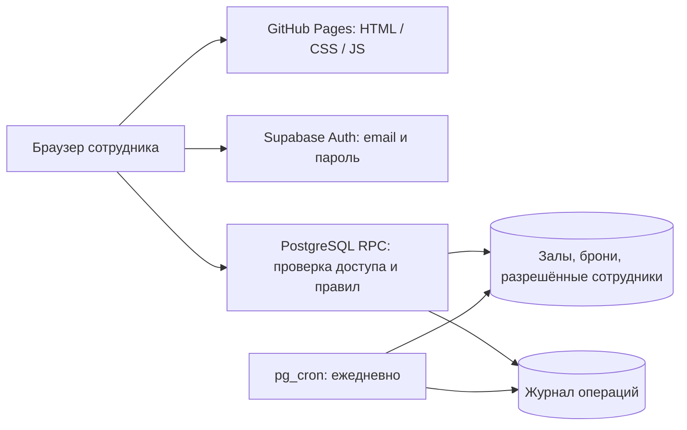

# Roomly 1.1 — версия для показа

**Начните с [presentation.html](presentation.html).** [Быстрый старт и подключение общей базы](docs/START.md) · [Сценарий показа](docs/SHOWCASE.md) · [Исправления после аудита](docs/RELEASE-1.1.md).

Ниже сохранено подробное руководство исходной поставки. Для обновления существующей базы используйте 003_release_1_1.sql, а не повторное создание таблиц. Актуальные результаты проверок приведены в RELEASE-1.1.md. Публикация и доступ к облаку — разные этапы: Supabase пока не подключён.

---

# Roomly — система бронирования конференц-залов

Готовые исходники веб-приложения по ТЗ и ответам заказчика. Русский интерфейс, 5 этажей, 10 стартовых залов, роли сотрудника и администратора, расписание, управление доступом и серверная защита от пересечений.

**Начните с `index.html`: откройте двойным щелчком.** Без настроек работает автономная демонстрация. В профиле (кнопка справа сверху) переключите роль на администратора, чтобы проверить управление. Данные демоверсии остаются только в текущем браузере. Это не общая база сотрудников.

Для совместной работы заполните `config.js` и выполните SQL в своём Supabase. После этого деморежим автоматически отключается и открывается настоящий вход по email и паролю. Нет скрытых платных библиотек, CDN, внешних шрифтов, аналитики или обязательного сборщика.

## Что находится в комплекте

| Файл/папка | Назначение |
|---|---|
| `index.html` | Точка входа, доступная и как локальный файл |
| `assets/styles.css` | Адаптивный интерфейс и анимации |
| `assets/core.js` | Проверки дат, времени, вместимости, прав; SVG-иллюстрации |
| `assets/api.js` | Supabase REST/Auth и отдельное локальное демохранилище |
| `assets/app.js` | Экраны, формы, обработчики действий |
| `assets/app.bundle.js` | Готовая браузерная сборка без сторонних зависимостей |
| `config.js` | Адрес проекта, публичный ключ и начальный часовой пояс |
| `supabase/` | Схема БД, серверные функции, годовое хранение, первый администратор |
| `.github/workflows/pages.yml` | Проверка и публикация GitHub Pages |
| `docs/RESEARCH.md` | Анализ аналогов с источниками и выбранные решения |
| `docs/REQUIREMENTS.md` | Соответствие ТЗ, допущения и границы MVP |
| `docs/TESTING.md` | Результаты проверок и приёмочные сценарии |
| `tests/` | Автоматические тесты правил; отдельные SQL/DOM-тесты |

Все названия залов, вместимость 24/8 мест и комплектация — стартовые примеры. Заказчик не предоставил фактический перечень. Администратор меняет их в интерфейсе. Продакшен-схема не создаёт демонстрационные бронирования и сотрудников.

## Что нужно сделать вам — только доступы и реальные сведения

1. Создать репозиторий GitHub и проект Supabase на своих аккаунтах.
2. Выполнить три подготовленных SQL-файла, заменив email первого администратора.
3. Указать публичные параметры Supabase в `config.js`.
4. Настроить email-подтверждение: для реальных сотрудников подключить свой SMTP в Supabase. Для небольшой проверки можно создать подтверждённых пользователей вручную через Supabase Dashboard.
5. Включить GitHub Pages и загрузить файлы проекта.
6. Войти администратором, внести реальные залы, добавить email сотрудников и проверить часовой пояс офиса.

Исходники, SQL, роли, дизайн, анимации, правила, тесты и сценарий публикации уже подготовлены. Доступа к вашим аккаунтам хостинга и почтовому серверу в этой работе не было; облачные ресурсы не созданы и публикация не выполнялась.

## Запуск общей системы: пошагово

### 1. Создайте Supabase

Откройте [Supabase](https://supabase.com/), создайте проект. Сохраните пароль БД в своём менеджере паролей. Регион выберите близкий к офису с учётом правил вашей организации.

Откройте **SQL Editor** и последовательно выполните:

1. Весь `supabase/001_schema.sql` — один раз в новом пустом проекте. Скрипт транзакционный; при ошибке установка откатывается.
2. Весь `supabase/002_retention.sql` — ежедневная очистка истории старше года. Если расширение `pg_cron` недоступно, включите его через Database → Extensions, затем повторите второй файл.
3. В `supabase/003_first_admin.sql` замените `REPLACE_WITH_YOUR_EMAIL@example.com` на **ваш email строчными буквами**, затем выполните файл. Не запускайте его без замены: заглушка намеренно не проходит ограничение БД.

В Supabase Authentication → Providers/Sign In включите вход Email с паролем и подтверждением email. Минимальная длина пароля — 12 символов. Список разрешённых сотрудников хранится в `public.members`; произвольная регистрация без записи в этом списке не даёт доступа к данным.

### 2. Подключите публичный клиент

В Supabase найдите Project URL и **publishable key** (или legacy `anon` key). Вставьте в `config.js`:

```js
window.ROOMLY_CONFIG = {
  supabaseUrl: "https://YOUR_PROJECT.supabase.co",
  supabaseKey: "YOUR_PUBLIC_PUBLISHABLE_OR_ANON_KEY",
  officeName: "Головной офис",
  timeZone: "Asia/Bishkek"
};
```

Публичный ключ рассчитан на присутствие в браузере. **Никогда не помещайте в проект `service_role`, secret key, пароль БД или SMTP.** Защиту данных обеспечивают серверные проверки и отсутствие прямых прав на таблицы, а не скрытность публичного ключа.

Должны быть заполнены оба параметра: URL и ключ. При пустых параметрах запускается демоверсия. При неверных непустых параметрах приложение показывает ошибку подключения, не переходит незаметно на локальные данные.

Часовой пояс в ТЗ не назван. Принято `Asia/Bishkek`. Если нужен другой, до создания рабочих броней измените `timeZone` в конфигурации и выполните:

```sql
update public.office_settings set time_zone = 'Asia/Almaty' where id;
```

Это пример альтернативы, а не автоматически выбранная зона. После входа серверная настройка имеет приоритет. Не меняйте пояс посреди эксплуатации без согласованного переноса расписания: даты/время хранятся как локальное время офиса.

### 3. Загрузите на GitHub

Создайте пустой репозиторий, например `roomly`. Загрузите **содержимое папки `roomly`**, чтобы `index.html` находился в корне репозитория. Не загружайте ZIP как единственный файл.

Вариант через Git, находясь в папке проекта:

```sh
git init
git add .
git commit -m "Add Roomly booking system"
git branch -M main
git remote add origin https://github.com/YOUR_LOGIN/roomly.git
git push -u origin main
```

Для публикации через подготовленный workflow: Repository → Settings → Pages → Source → **GitHub Actions**. Во вкладке Actions запустите `Check and deploy Roomly`, если первый запуск до включения Pages завершился ошибкой. Публикуются только HTML, конфигурация, CSS, JS и favicon; SQL и документация не входят в сайт.

Альтернатива без Actions: Settings → Pages → Deploy from a branch → `main` / `(root)`. Готовый bundle уже включён. При таком способе весь репозиторий становится статическим сайтом; секретов в нём быть не должно.

Адрес будет вида `https://YOUR_LOGIN.github.io/roomly/`. Платные возможности GitHub не требуются для публичного репозитория; для приватного репозитория доступность Pages зависит от тарифа.

### 4. Настройте почту и URL входа

В Supabase Authentication → URL Configuration задайте Site URL равным точному адресу сайта **с путём репозитория и завершающим `/`**. Добавьте его же в разрешённые Redirect URLs. Для разработки при необходимости добавьте `http://localhost:4173/` и `http://127.0.0.1:4173/`.

Для реальных регистраций и сброса пароля подключите Custom SMTP: сервер, порт, логин, пароль и подтверждённый адрес отправителя. Эти значения вводятся только в Supabase Dashboard. Встроенный SMTP Supabase ограничен и не предназначен для отправки всем 450 сотрудникам. Это авторизационные письма; уведомления о встречах по согласованию отложены.

Зарегистрируйтесь в Roomly с email первого администратора, подтвердите письмо, войдите. Если тестируете без своего SMTP, используйте Supabase Authentication → Users для создания подтверждённого тестового пользователя с тем же email; пароль задаёте сами. Не отключайте проверку подтверждения email в серверном коде.

### 5. Наполните справочники

В «Управление» проверьте названия, этажи, вместимость и оборудование. Добавьте разрешённые email сотрудников; возможны личные адреса, как разрешено заказчиком. После этого сотрудник регистрируется самостоятельно. Нового администратора назначайте в этой же форме. Свой доступ администратор не может отключить или понизить через приложение.

Массовый первоначальный импорт выполняется SQL, например:

```sql
insert into public.members(email,role,active) values
('employee1@example.com','employee',true),
('employee2@example.com','employee',true)
on conflict(email) do update set active=true;
```

Используйте только согласованные реальные адреса. В Supabase SQL Editor работает владелец БД с широкими правами; обычные сотрудники доступа туда не получают.

### 6. Проведите приёмку

Откройте сайт двумя разными аккаунтами и выполните сценарии из `docs/TESTING.md`. Проверьте доставку писем и реальную конкурентную бронь. После проверки передайте административную часть охране здания, техническую — отделу разработки.

## Архитектура и защита



- Право на каждую операцию определяется сервером через подтверждённую учётную запись и активный email в allowlist. Нельзя назначить себе администратора через JS или metadata.
- Посетители без входа не читают данные. Прямые SELECT/INSERT/UPDATE/DELETE обычным ролям не выданы. RLS включена, API — только явно разрешённые RPC.
- `owner_id` и email брони сервер берёт из учётной записи; данные клиента не могут их подменить.
- `EXCLUDE USING gist` и полуоткрытый диапазон `[начало, конец)` запрещают двойную бронь на уровне PostgreSQL, включая гонку запросов. Бронь встык разрешена.
- Изменения сериализованы короткой транзакционной advisory-блокировкой; отключение зала и отмена связанных броней атомарны.
- Журнал бизнес-операций ведётся сервером; неудачные попытки допущенных сотрудников тоже сохраняются. События входа дополнительно фиксирует Supabase Auth, с собственным сроком хранения провайдера.
- Токены находятся в `sessionStorage` вкладки, а не в исходниках. Пароли обрабатывает Supabase Auth. Есть обновление токена и сброс пароля.
- Текст пользователей экранируется. Указана CSP; скрипты/стили приложения локальные. Внешних картинок и трекеров нет.
- Проверка версии расписания каждые 60 секунд загружает маленький ответ; полный снимок запрашивается при изменениях. При скрытой вкладке опрос приостановлен. При сохранении конфликт снова проверяет БД.

## Размер и эксплуатация

На сайте нет тяжёлых медиа и внешнего UI-фреймворка. Иллюстрации — SVG, анимации — CSS. Режим `prefers-reduced-motion` отключает движение. Итоговые размеры указаны в `docs/TESTING.md`.

Free tier подходит для проверки MVP, **не является обещанием бесплатной безлимитной эксплуатации**. Supabase Free на момент исследования: 500 MB БД, 5 GB исходящего трафика, пауза после недели неактивности. Автоматические резервные копии не включены. Следите за Usage; при частых изменениях и накоплении годовой истории полный снимок расписания расходует трафик. Нагрузочное испытание 450 одновременных пользователей не проводилось. Перед массовым запуском нужна проверка на фактическом числе встреч и активных пользователей.

GitHub Pages служит только клиентом. Удаление истории браузера в рабочем режиме не удаляет БД. В демоверсии удаление локального хранилища удаляет демоданные.

Для закрытой внутренней сети разместите эти же статические файлы на внутреннем HTTPS-сервере и согласуйте доступ к БД. GitHub Pages сам по себе не ограничивает сайт корпоративной сетью. AD, календарные интеграции и резервное копирование относятся ко второму этапу.

## Разработка и тесты

Для простого просмотра Node.js не нужен. Для разработки — Node.js 20+:

```sh
npm run build
npm run check
npm test
npm start
```

Сервер: `http://127.0.0.1:4173`. После изменения модулей JS обязательно выполните `npm run build`, чтобы обновить `app.bundle.js`. CSS и `config.js` пересобирать не нужно.

Дополнительные SQL/DOM-тесты устанавливают зависимости отдельно от сайта:

```sh
npm ci --prefix tests/integration
npm run test:integration
```

Они используют временную PostgreSQL/PGlite и симуляцию DOM, не подключаются к рабочей БД и не отправляют письма. Папку `node_modules` не загружайте в GitHub. Реальная облачная авторизация, SMTP и браузеры проверяются после настройки вашего окружения.
